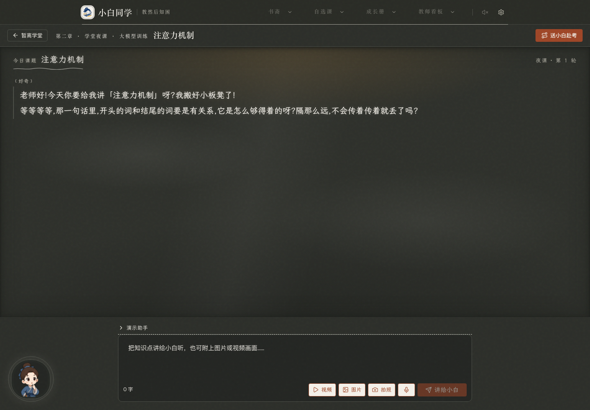
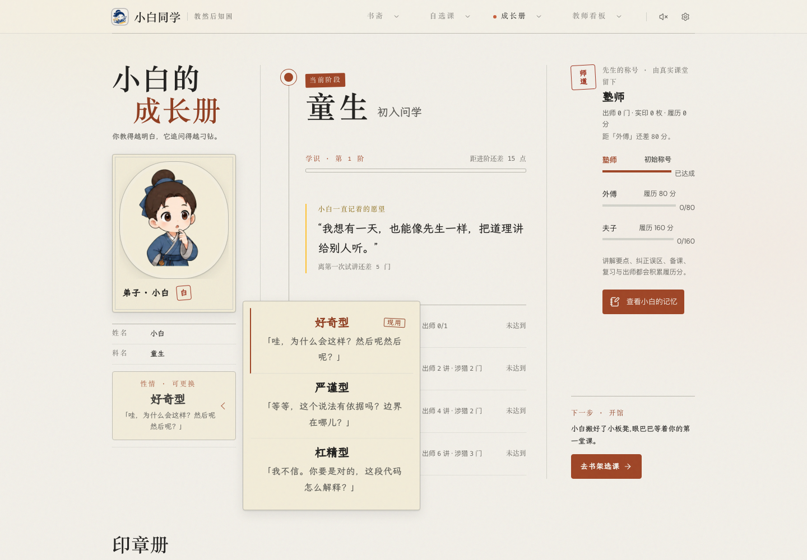
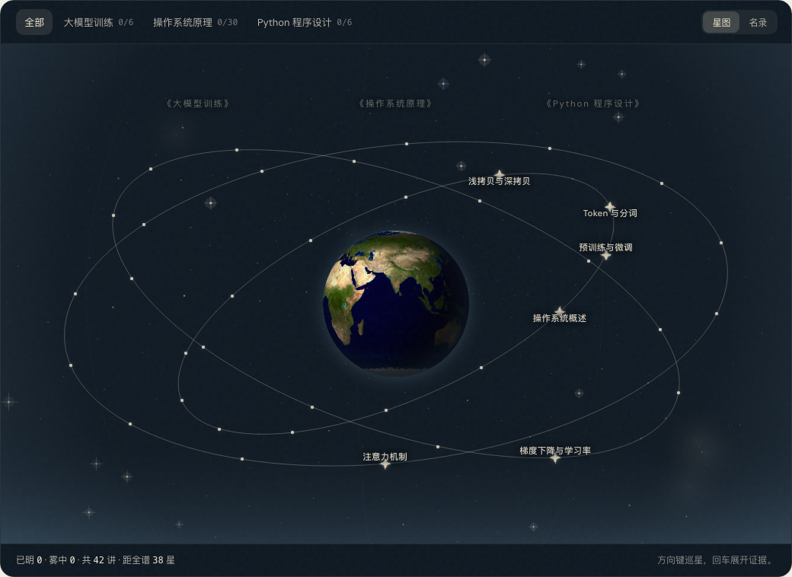
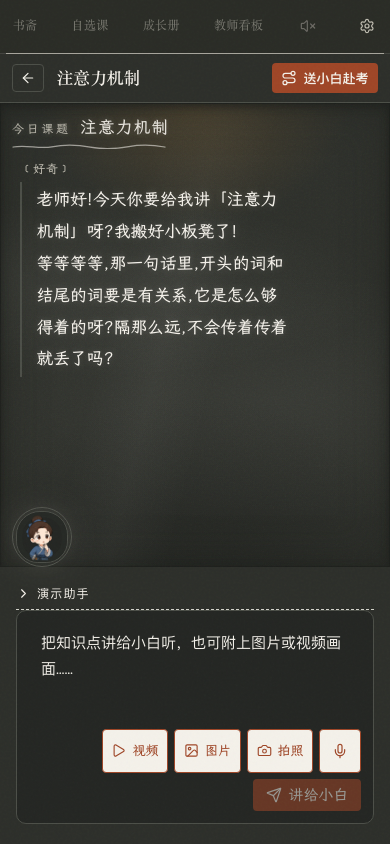
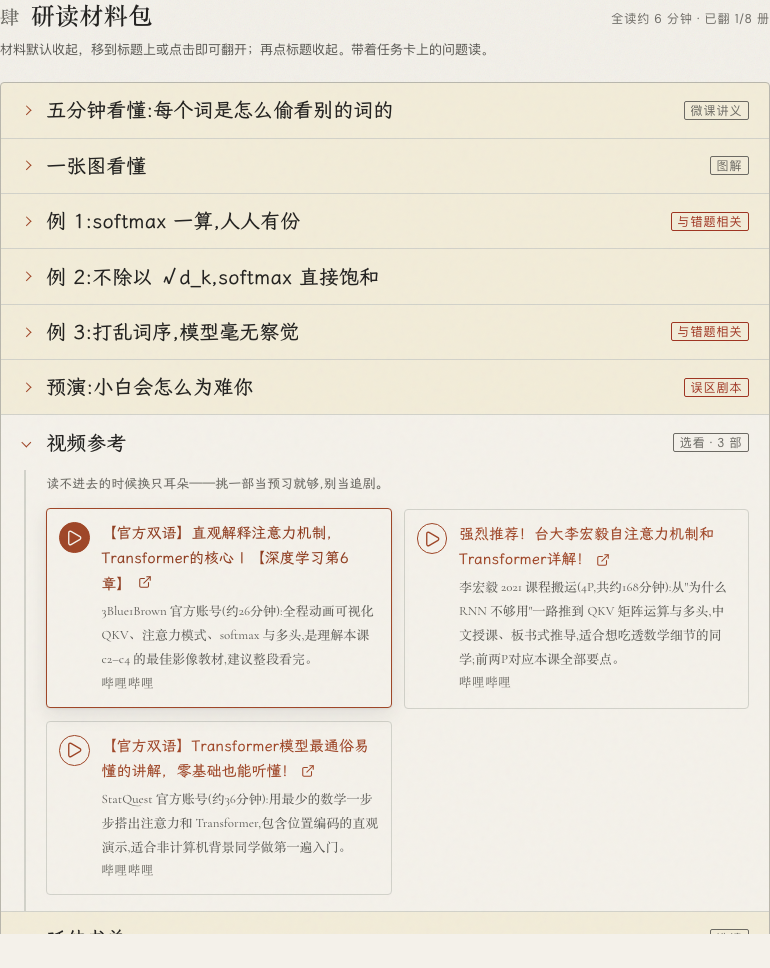

# 1012 修复验收

依据：用户提供的 `doc/修复 1012/1.docx` 与 `环轨.html`。用户另确认删除截图中的空 C++ 课程。

## 改动

- 讲课页：黑板与导航铺满视口，左下小白头像点击展开原简介；居中输入框内包含图片、拍照、视频、语音和发送。保留暂离回备课、课后赴考与独立对话滚动。
- 视频：在浏览器本地播放，先生暂停并选取一帧，经过既有图片压缩与视觉链路发送；整段视频、音轨不上传。界面明确说明这一边界。
- 修复麦克风在 React StrictMode 再挂载后未复位 `disposedRef` 的问题。
- 备课材料：初始全收起；鼠标进入展开，移出保持展开，点击标题收起；保留触屏点击、键盘与 `inert`。五步圆点以虚线相连，删去侧栏重复路线图，保留正文第三步。
- 成长册：五个科名圆点都可展开学识点数预览，实际科名仍按原出师/课程条件派生。学识与科名相互独立，未来阶预览不写事件、不升级。
- 先生称号：统一为塾师（初始）、外傅（80 履历分）、夫子（160 履历分），展示条件与进度；保留真实事件计分口径。
- 性情：桌面右拉菜单中间选项与卡片居中对齐，名称居中、文字间距增大；增强记忆入口及暂停记忆按钮。
- 星海：使用参考 HTML 的地球贴图与环轨构图，选择知识星后切到地平线；保留课程筛选、名录、锁定、状态、字体、最多三条真实星链、证据卡、键盘与移动滚动。

## 本地验证

- 主站 lint、TypeScript/Vite 构建、增长/记忆/主题/鉴权/自选课/课堂澄清/同步/反馈契约通过；lint 仅两条原有 `fsImpl.ts` warning。
- 教学全链路仿真：1567 项通过。
- 管理后台测试、lint、生产构建通过。
- 服务端：252 项全部通过，runtime check 通过。原超时模拟仅留下悬空 Promise，因客户端定时器 `unref` 导致 Node 提前退出；测试现在模拟真实网络句柄并在 abort 时释放，生产逻辑不变。
- 1440×1000 与 390×844 浏览器检查：无页面错误、无横向溢出；五阶段预览不改变真实科名；材料初始折叠/hover 展开/移出保持/点击关闭；头像简介与 Esc；课堂发送通过。
- 媒体检查：视频本地取帧、图片预览与移除、浏览器录音及模拟语音转写通过。未发起付费真实模型验收请求。
- 机械设计检查的已有边线/进度动画提示保持；本次新增的球体宽度动画已改为 transform。

## 发布状态

已推送分支 `codex/fix-1012-orbit-classroom`，PR：<https://github.com/fantay0312/xiaobai-tongxue/pull/63>（Open，未合并）。运行时代码为 `ea4f5815a2aa48ef6bfd6f0becaf730dadeaf77e`。

- 生产 release：`20261012-fix1012-b7b768`。
- 完整运行包 SHA-256：`cc12322ad1bd737f26d51119657f59fad07dbc334d469d77af3ffa198126468a`。
- 已完整备份运行包、兼容状态、nginx、环境文件及 PostgreSQL。使用 PostgreSQL 18 客户端导出，在隔离临时 PostgreSQL 18 恢复成功，核对 9 个迁移、40 张业务表。
- 候选服务验证 PostgreSQL/Redis/COS、主站/后台静态索引精确匹配、`/api/me` 与套餐目录 200、后台匿名 401 后，整体切换运行包；未修改 DNS/CDN 拓扑。
- 生产 `xiaobai.service` 为 active；主站/后台/身份/套餐入口正常，后台仍要求独立认证。
- <https://xiaobai.tokentosea.com/> 返回 200，公开首页与本地新构建逐字节相同，Cache-Control 为 `no-cache`，入口静态资源全为 200；不需要刷新 CDN。
- 空 C++ 课程清理前重新加行锁核对：资料、课题、编译任务、上传补偿任务均为 0，两个 WeKnora 知识库 total 均为 0。保存课程及知识库元数据后，删除 1 门课程和 2 个空知识库，确认课程剩余记录为 0。
- GitHub 初次上传后的 CodeRabbit 与 GitGuardian 检查为 Success。

受限备份目录：`/var/backups/xiaobai/20261012-fix1012-b7b768`。`runtime-before-switch` 是切换前完整服务目录；`runtime-state-config.tgz` 包含兼容状态与配置；`production.dump` 为数据库备份；`empty-cpp-course.json` 为清理前课程/知识库元数据；候选、上线和清理检查分别保存为 JSON。数据库清理独立于运行包更新，恢复旧运行包不会自动恢复删除的课程。

## 页面截图

生产备份与回滚资料保留在服务器受限备份目录，不上传凭据、用户资料或数据库备份到 GitHub。
