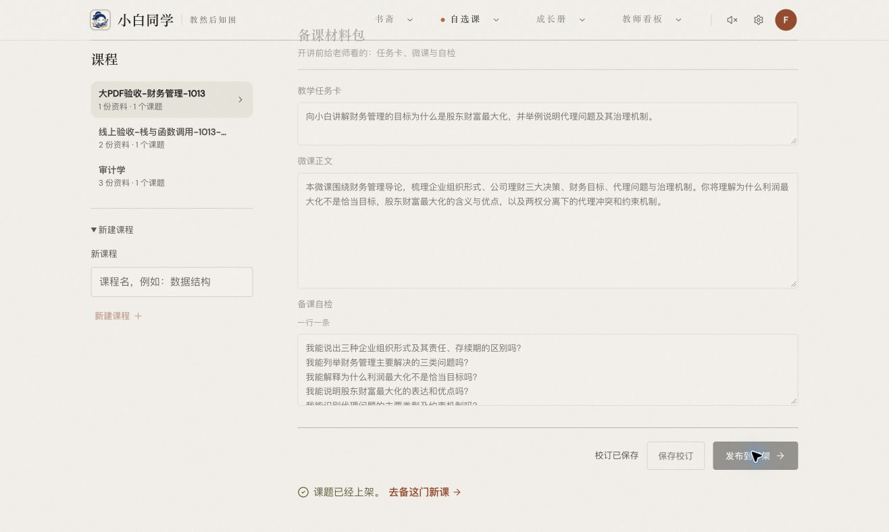
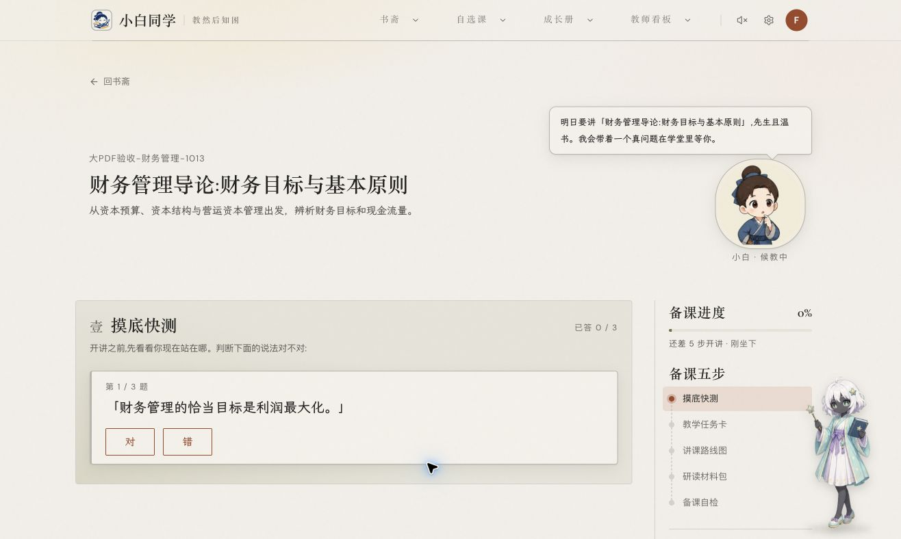

# 大 PDF 全流程与 WeKnora 升级验收

2026-10-13 在线上 `https://xiaobai.tokentosea.com` 使用已登录账号完成真实上传、解析入库、生成草稿、编辑保存、发布及打开备课页。结果通过；保存请求由上一次小文件验收的 23.791 秒降到本次 2.346 秒。两个样本并非受控基准，不能据此承诺所有网络环境的固定速度。

## 线上实测

测试课件为财务管理导论 PDF，7,926,478 字节、62 页，SHA-256 为 `2a21f607584fe54049731d5a1865163681aeb2594e207f7c97598f8d120e8e75`。文件含授课资料及联系方式，仓库只保存校验值与界面证据，不保存原文件。

| 阶段 | 实测 | 结果 |
| --- | --- | --- |
| 上传 | HTTP 202，103.708 秒；应用处理 535.9 毫秒 | 成功接收 |
| 解析入库 | 服务器资产创建到完成约 33.361 秒 | completed / enabled，无错误 |
| 生成草稿 | 任务创建到草稿落库约 63.839 秒 | 6 个知识要点、5 个易错点、5 道题，质量问题为空 |
| 编辑保存 | HTTP 200，2.346 秒；应用处理 39.3 毫秒 | 修改后的简介保存成功，界面约 2.654 秒确认 |
| 发布 | HTTP 200，5.025 秒；应用处理 3.554 秒 | topic ready，job done，有 published_at |
| 打开备课页 | teacher 接口 HTTP 200，548 毫秒 | 课程标题、修改后的简介及摸底题正常展示 |

整个流程只发送一次 `/draft` 保存请求；发布没有重复保存。关键接口全部成功，未出现失败后永久停止轮询或空白页。浏览器原始请求计时见 `metrics.json`，最终数据库状态见 `evidence.json`。

上传仍明显受应用之外的传输阶段影响：浏览器总耗时约 104 秒，而请求进入应用后的耗时约 0.54 秒。当前证据只能定位等待主要发生在应用处理之前，不能继续区分本地网络、边缘节点或上游代理缓冲；本次未修改腾讯云配置，也不声称消除了所有网络超时。

已发布的验收课题：[财务管理导论：财务目标与基本原则](https://xiaobai.tokentosea.com/#/prep/custom-a9535d05-377f-4dba-8624-e230d9a27639-d6129fba-ab7d-4021-af40-de6a25a65cbe)。

## 修复与部署

- `d38dea0`：发布时复用已保存草稿，版本化来源缓存与并发请求合并，状态读取和分页总超时，失败退避后继续探测，离线及隐藏页面取消读取，并补充 Server-Timing 计时。
- `fd57f53`：本次实测发现动态模块下载偶发失败可导致空白页；加入有限重试、错误恢复界面，并按需挂载资料和设置弹窗。不会自动无限刷新页面。
- `f350c57`：锁定并核验 WeKnora v0.8.2 镜像内容，补充回归断言。

以上代码已推送 GitHub `main`。应用后端部署版本为 `d38dea0`，前端为 `fd57f53`，后续运维文件独立同步，无需再次重启应用。

验证通过：267 个后端测试、认证状态与生命周期测试、自选课 56 项断言及 9 个恢复测试、模块加载恢复测试、TypeScript、应用构建与 lint。lint 仅保留 `os/fsImpl.ts` 原有的两处转义警告。

应用备份：`/var/backups/xiaobai/performance-20261013T140244Z`；前端备份：`/var/backups/xiaobai/module-recovery-front-20261013T140949Z`。

## WeKnora v0.8.2

升级到[官方 v0.8.2](https://github.com/Tencent/WeKnora/releases/tag/v0.8.2)，源码提交 `3e8b0bfc80b845b2d4b2ed683994748741450a97`。先在隔离数据库恢复生产备份，验证既有资料 5 个分块可读、7.9 MB PDF 新增 33 个分块、FAQ 写入与进度完成，再切换生产。演练解析约 25.963 秒。

生产 app/docreader 均为 v0.8.2 且健康，见 `weknora-production-proof.json`。升级保留应用进程及已登录会话，写入暂停约 16.61 秒。PostgreSQL、Redis 主版本保持原样；未变更腾讯云验证码、网络或存储配置。

离线导入后的实际镜像 ID 与官方直接拉取的配置 ID 不同，已使用锁文件核验文件层与运行配置内容、平台及源码提交。生产固定实际不可变 ID；具体核验说明见 [sidecar README](../../../deploy/weknora-sidecar/README.md)。

备份与回滚材料：`/var/backups/xiaobai/weknora-upgrade-20261013T135821Z/final`。回滚需要同步恢复数据库、解析文件及队列，不能只退回镜像。验收结束后已停止演练服务，并清除临时私有存储传输对象。
