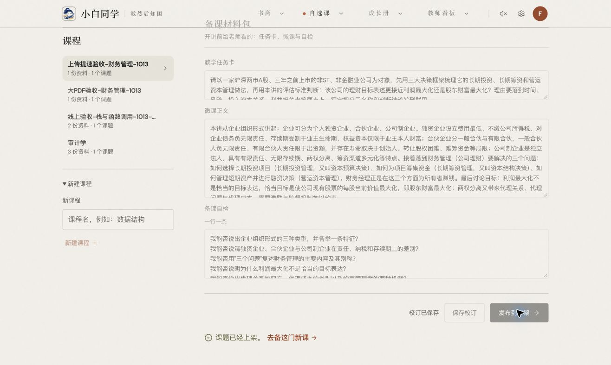

# 大 PDF 上传提速与完整发布验收

2026-10-13，在生产站使用与上轮完全相同的 62 页 PDF 完成上传、解析、生成草稿、编辑保存、发布及打开备课页。全流程通过。本轮上传约 **48.0 秒**，此前为 **103.7 秒**，缩短约 **54%**。这是同文件的两次实测，并非受控网络基准或固定速度保证。

## 实测结果

| 阶段 | 耗时 | 验收结果 |
| --- | --- | --- |
| 选择文件到上传响应完成 | 48.015 秒 | 含读取文件、准备哈希、初始化、分块上传及最终校验 |
| 初始化请求到上传响应完成 | 47.685 秒 | 8 块全部一次成功，无分块重传 |
| 解析入库 | 25.627 秒 | completed / enabled，文件哈希与原件一致 |
| 生成草稿 | 45.918 秒 | 7 条讲解要点、4 个误区、8 道题，质量问题为空 |
| 修改并保存简介 | 2.796 秒 | HTTP 200，服务器处理 37.9 毫秒 |
| 发布到书架 | 5.693 秒 | HTTP 200，服务器处理 3.556 秒；仅一次保存、一次发布 |
| 打开备课页 | teacher 接口 1.158 秒 | 标题、修改后的简介、摸底题及备课步骤正常显示 |

上传初始化 514 毫秒，完成校验接口 932 毫秒，其中服务端处理 474.5 毫秒。各分块约 10.7–24.0 秒，剩余时间仍主要在文件传输阶段。此次没有修改腾讯云、验证码、网络、存储桶策略或 CAM 权限。

测试文件：7,926,478 字节，SHA-256 `2a21f607584fe54049731d5a1865163681aeb2594e207f7c97598f8d120e8e75`。只保存校验值、界面截图及脱敏计时，原始课件不进入仓库。

已发布的测试课题：[财务管理基本决策与目标](https://xiaobai.tokentosea.com/#/prep/custom-3f58f24c-3e92-4e39-a9c7-ed25e0bfa2ee-a0f903d4-872a-4176-ba87-89bd1b1679a4)。最终数据库状态与哈希见 `evidence.json`；浏览器计时见 `metrics.json`，单独的上传计时见 `upload-metrics.json`。

## 实现和检查

代码提交 `88afcb462f3eb65041ed821b68438d269e593f21` 已推送 GitHub `main` 并部署生产。

- 大于等于 2 MiB 的文件使用 1 MiB 分块、最多 3 个并发请求；小文件保留原有上传路径。
- 失败分块独立重试，初始化和完成请求具备幂等语义，响应丢失不会重复入库。
- 服务端先核对课程归属、文件大小和类型，再暂存分块；校验完整文件 SHA-256 后才进入原有 COS、WeKnora 及数据库事务。
- 暂存空间有总量、会话数、时限与访问隔离；完成、取消和过期上传清理临时文件。前端显示实际已接收字节进度。
- 272 个后端测试通过，覆盖乱序、跨账号访问、错误长度、分块冲突、哈希错误、容量限制、取消、过期及重复提交；前端上传并发、重试、字节一致性、进度、取消和认证测试通过。
- 自选课与认证回归测试、TypeScript、构建和 lint 通过。lint 保留 `os/fsImpl.ts` 已有的两处转义警告。

部署先在 18071 端口验证主页、登录状态和目录接口正常、受保护接口拒绝匿名访问，再切换生产。回滚备份：`/var/backups/xiaobai/chunk-upload-20261013T144416Z`。部署证明见 `deployment-proof.json`。没有新增依赖或数据库迁移；WeKnora 继续使用已验收的 v0.8.2。
